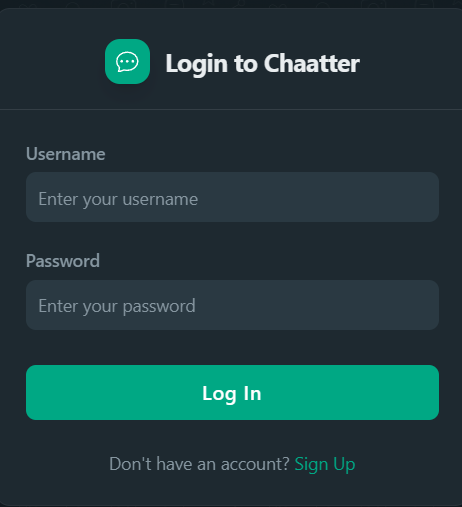
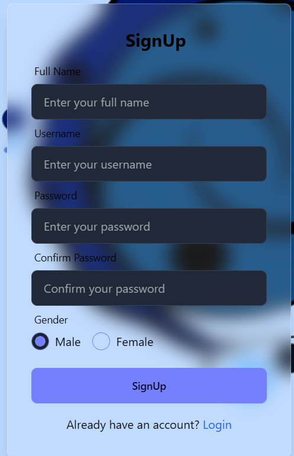
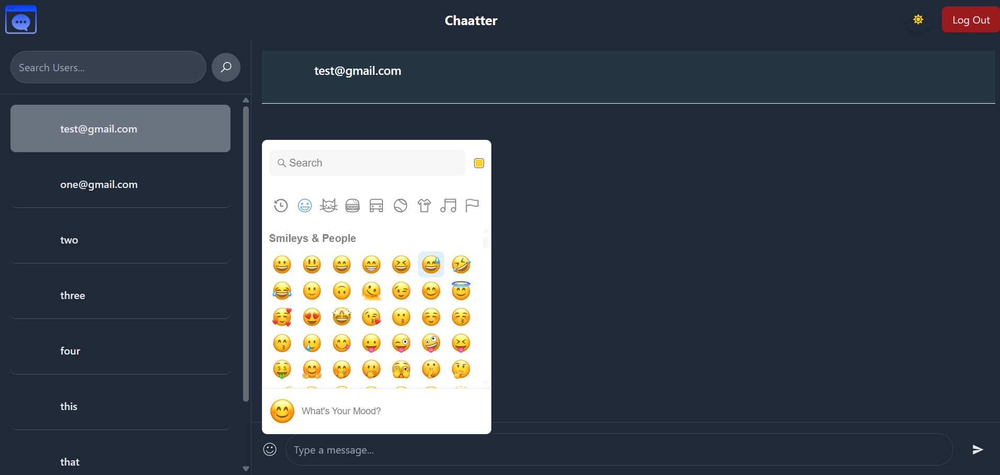
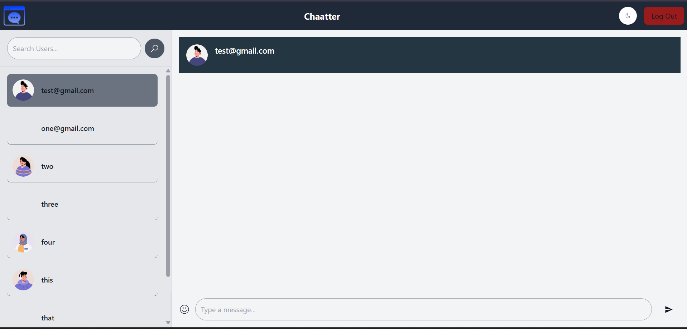

# Chatter - Real-Time Chat Application

A full-stack, modern real-time chat application built utilizing React, Node.js, Express, and Socket.IO.

---

## Features

* **Real-Time Messaging:** Instantaneous event-driven communication powered by Socket.IO.
* **Emoji Integration:** Comprehensive emoji picker support for richer user interactions.
* **Secure Authentication:** JWT-based user authentication and secure routing.
* **Versatile Chat Options:** Built-in support for one-on-one and group messaging.
* **State Management:** Robust, centralized frontend data handling using Redux.
* **Modern UI:** Clean, responsive, and themeable interface constructed with TailwindCSS.
* **Scalable Backend:** RESTful API architecture structured with Express.js and MongoDB.
* **Connection Resilience:** Automatic socket reconnection handling on network drops.

---

## Folder Structure

```
chatter/
├── backend/
│   ├── config/
│   ├── controllers/
│   │   ├── messageController.js
│   │   └── userController.js
│   ├── middlewares/
│   │   └── isAuthenticated.js
│   ├── models/
│   ├── routes/
│   │   ├── messageRoute.js
│   │   └── userRoute.js
│   ├── socket/
│   ├── .env
│   ├── index.js
│   ├── package.json
│   ├── package-lock.json
│   └── .gitignore
│
├── frontend/
│   ├── public/
│   │   ├── bg.jpg
│   │   ├── chatter.png
│   │   └── chatter.ico
│   ├── src/
│   │   ├── assets/
│   │   ├── components/
│   │   │   ├── ChatHeader.jsx
│   │   │   ├── ChatMessage.jsx
│   │   │   ├── HomePage.jsx
│   │   │   ├── Login.jsx
│   │   │   ├── Message.jsx
│   │   │   ├── MessageContainer.jsx
│   │   │   ├── OtherUser.jsx
│   │   │   ├── SendMessage.jsx
│   │   │   └── Signup.jsx
│   │   ├── hooks/
│   │   ├── redux/
│   │   ├── socket/
│   │   ├── App.jsx
│   │   ├── App.css
│   │   ├── index.css
│   │   └── main.jsx
│   ├── index.html
│   ├── .gitignore
│   ├── package.json
│   ├── package-lock.json
│   ├── postcss.config.js
│   ├── tailwind.config.js
│   ├── vite.config.js
│   ├── eslint.config.js
│   └── README.md
```

---

## Installation

```bash
# Clone the repository
git clone https://github.com/Vijaykr35/chatapp.git
cd Chatter

# Backend Setup
cd backend
npm install
cp .env.example .env  # Ensure Mongo URI, JWT_SECRET, and PORT are configured
npm start

# Frontend Setup
cd ../frontend
npm install
# Configure environment routing parameters
echo "VITE_BACKEND_URL=http://localhost:8080/api/v1" > .env
echo "VITE_SOCKET_URL=http://localhost:8080" >> .env
npm run dev
```

---

## Example Usage

* Register a new account or authenticate an existing user session.
* Initiate one-on-one discussions seamlessly.
* Utilize the integrated emoji picker to enhance message expression.
* Experience immediate, real-time message synchronization universally via Socket.IO.

---

## Screenshots

| Login Page | Signup |
| :---: | :---: |
|  |  |

| Chat UI (Dark Mode) | Chat UI (Light Mode) |
| :---: | :---: |
|  |  |

---

## Tech Stack

| Layer     | Technology                         |
| --------- | ---------------------------------- |
| Frontend  | React, TailwindCSS, Redux, Vite    |
| Backend   | Node.js, Express, MongoDB          |
| Real-Time | Socket.IO                          |
| Auth      | JSON Web Tokens (JWT)              |
| Utilities | `emoji-picker-react`               |

---

## Maintainer

**Vijay Kumar**
