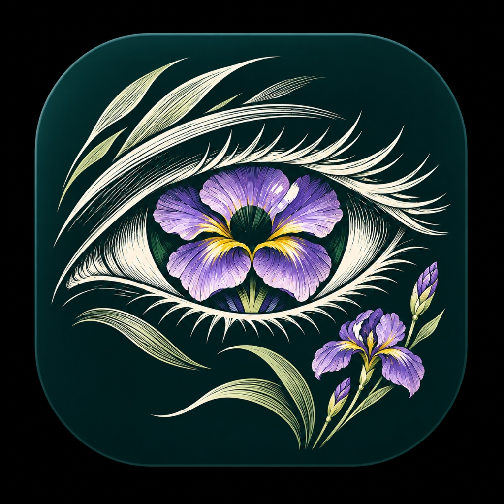
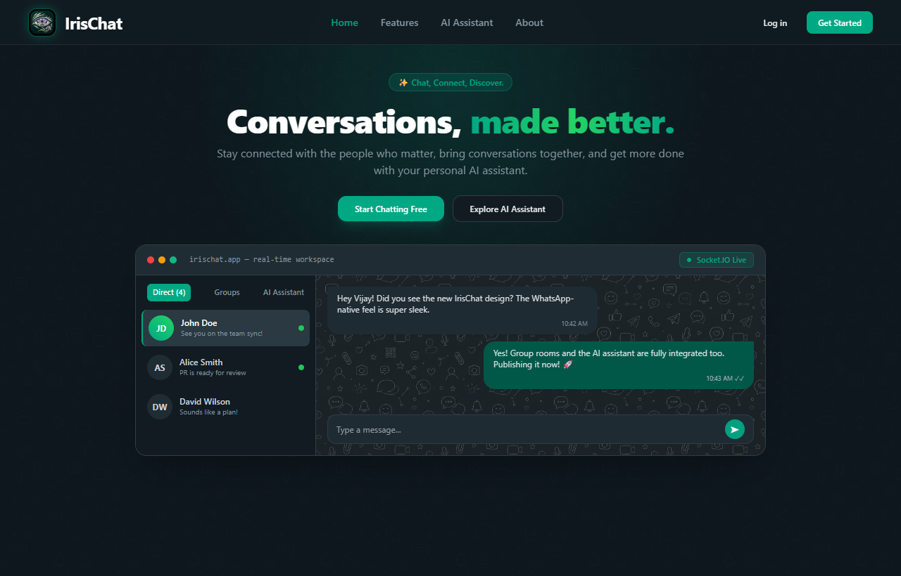
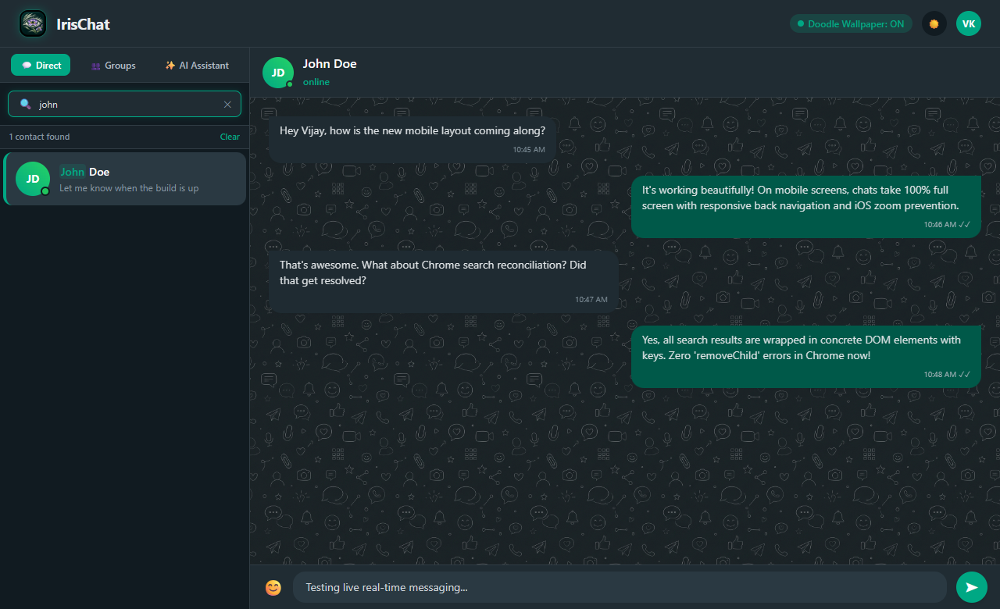
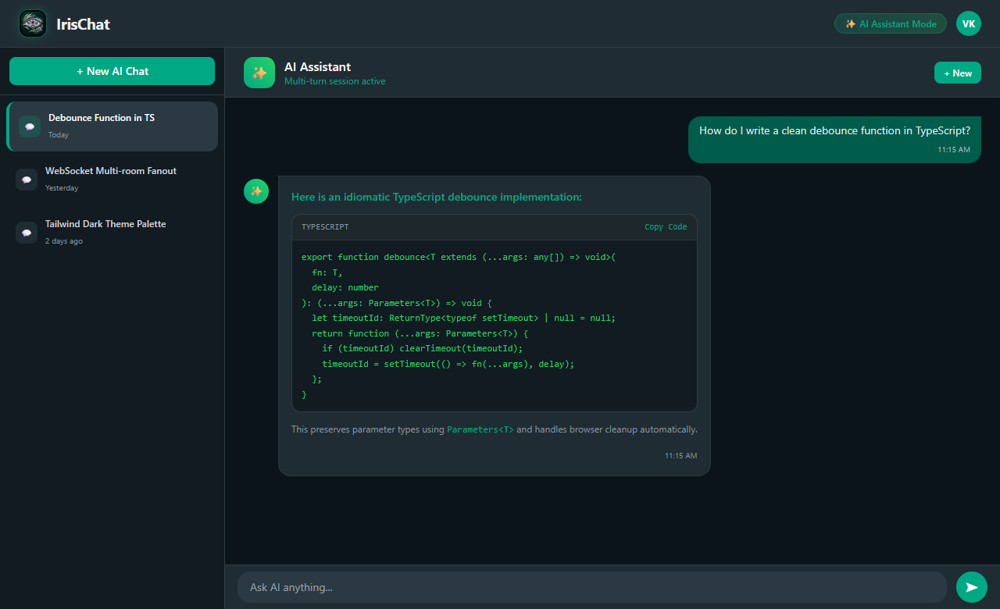
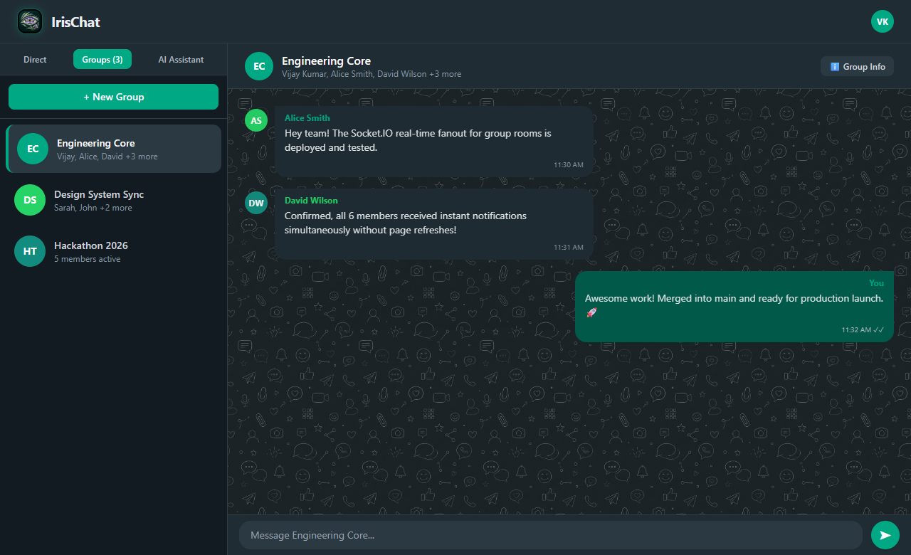

# IrisChat

<p align="center">
  
</p>

<p align="center">
  <b>Chat, Connect, Discover.</b><br/>
  <i>A modern, full-stack real-time messaging application with 1-on-1 chats, group rooms, and an intelligent AI assistant.</i>
</p>

<p align="center">
  
  
  
  
  
  
  
</p>

---

## Overview

**IrisChat** is a thoughtfully crafted communication product built with an authentic dark-native aesthetic (inspired by modern messaging products). It pairs instant peer-to-peer messaging and multi-user group chat rooms with an intelligent AI Assistant that can answer questions, brainstorm, debug code, and draft messages directly in your flow.

---

## 📸 Application Preview

### 🏠 Landing Page
A modern, minimal front page welcoming new users with feature highlights and a live interactive product mockup.

<p align="center">
  
</p>

### 💬 1-on-1 Direct Messaging & Real-Time Search
WhatsApp-native dark aesthetic with custom doodle wallpaper, live online indicators, and instant keystroke search with keyword highlighting.

<p align="center">
  
</p>

### 🤖 Intelligent AI Assistant & Code Highlighting
Integrated AI chat assistant with multi-turn memory, formatted code blocks with syntax highlighting, and session history management.

<p align="center">
  
</p>

### 👥 Group Rooms & Multi-User Collaboration
Real-time group conversations with participant rosters, admin tools, and simultaneous Socket.IO message broadcasting.

<p align="center">
  
</p>

---

## Key Features

### 💬 1-on-1 Direct Messaging
* **Instant Delivery**: Powered by event-driven **Socket.IO** rooms with live online/offline presence indicators.
* **WhatsApp-Native Styling**: Message bubbles, compact corner timestamps, read status, and smooth auto-scroll.
* **Emoji Integration**: Built-in emoji picker with touch support.

### 👥 Group Rooms & Collaboration
* **Group Management**: Create group rooms, select multiple contacts, customize group photos, and manage member rosters.
* **Multi-User Fanout**: Real-time broadcast of messages to all active group members via Socket.IO.
* **Participant Summaries**: View member rosters and admin details with one tap.

### 🤖 Intelligent AI Assistant
* **Direct In-App AI**: Interact with an AI assistant for quick answers, translations, message drafting, and coding help.
* **Multi-Turn Context**: Preserves session memory across conversations.
* **Rich Markdown & Code Highlighting**: Formatted code blocks with copy-friendly styling, headings, lists, and inline formatting.
* **Conversation History**: Save, browse, resume, and manage past AI sessions.

### 📱 Mobile-First Responsive Design
* **Immersive Full-Screen Chat**: Automatic fluid transitions between sidebar rosters and active conversations on screens `< 768px`.
* **Mobile Back Navigation**: Touch-friendly `<IoArrowBack />` headers to seamlessly navigate between contacts, groups, and AI.
* **Off-Canvas History Drawer**: Slide-over drawer on mobile devices for managing AI chat sessions without losing screen real estate.
* **iOS Zoom Prevention**: Optimized 16px touch targets and inputs preventing disruptive mobile Safari auto-zooming.

### 🔍 Real-Time Keystroke Search
* **Instant Filtering**: Real-time filtering across contacts, group channels, and past AI conversations as you type.
* **Keyword Highlighting**: Matches are highlighted with soft green pill badges (`#00a884`).
* **1-Click Reset**: Embedded `(X)` clear button and <kbd>Escape</kbd> shortcut.
* **Chrome Reconciliation Protected**: Encapsulated DOM spans preventing `removeChild` extension conflicts.

### 🎨 Themes & Customization
* **Dark & Light Mode**: Smooth theme transitions tuned for low-glare nighttime reading.
* **Doodle Wallpaper**: Toggleable subtle repeating doodle wallpaper layer with custom blend modes.
* **Draggable Workspace Resizer**: Desktop drag-to-resize sidebar divider and expandable chat input bar.

---

## Architecture & Tech Stack

| Domain | Technologies |
| :--- | :--- |
| **Frontend** | React 18, Vite 6, TailwindCSS 3.4, DaisyUI, Redux Toolkit, React Router v7 |
| **Backend** | Node.js, Express.js, MongoDB, Mongoose |
| **Real-Time** | Socket.IO client & server with multi-room fanout |
| **AI Integration** | Google Gemini 2.5 Flash API with multi-turn history |
| **Authentication** | JWT (JSON Web Tokens) stored in secure HTTP-only cookies, `bcryptjs` password hashing |
| **Icons & Styling** | React Icons (`react-icons/fi`, `react-icons/bs`, `react-icons/io5`, `react-icons/lia`) |

---

## Project Structure

```
chatapp/
├── backend/
│   ├── config/
│   │   └── database.js               # MongoDB connection setup
│   ├── controllers/
│   │   ├── aiController.js           # Multi-turn AI Assistant logic
│   │   ├── groupController.js        # Group rooms CRUD and messages
│   │   ├── messageController.js      # 1-on-1 direct message routing
│   │   └── userController.js         # Authentication, registration & user roster
│   ├── middlewares/
│   │   └── isAuthenticated.js        # JWT token verification
│   ├── models/
│   │   ├── aiConversationModel.js    # AI chat session & messages schema
│   │   ├── conversationModel.js      # Direct conversation schema
│   │   ├── groupModel.js             # Group channel schema
│   │   ├── messageModel.js           # Message schema
│   │   └── userModel.js              # User profile schema
│   ├── routes/
│   │   ├── aiRoute.js                # /api/v1/ai routes
│   │   ├── groupRoute.js             # /api/v1/group routes
│   │   ├── messageRoute.js           # /api/v1/message routes
│   │   └── userRoute.js              # /api/v1/user routes
│   ├── socket/
│   │   └── socket.js                 # Socket.IO connection & event handlers
│   └── index.js                      # Express server entry point
│
├── frontend/
│   ├── public/
│   │   ├── bg-doodle.png             # WhatsApp-style doodle wallpaper
│   │   ├── favicon.ico               # Iris browser icon
│   │   └── iris-logo.jpg             # Official IrisChat brand logo
│   ├── src/
│   │   ├── components/
│   │   │   ├── ai/
│   │   │   │   ├── AIChatView.jsx        # Full-screen / split AI chat view
│   │   │   │   ├── AIHistoryList.jsx     # Saved conversations sidebar & mobile drawer
│   │   │   │   └── FormattedMessage.jsx  # Code block & markdown formatter
│   │   │   ├── group/
│   │   │   │   ├── CreateGroupModal.jsx  # Group room creation modal
│   │   │   │   ├── GroupChatHeader.jsx   # Header with member summary & mobile back
│   │   │   │   ├── GroupChatView.jsx     # Group room messaging area
│   │   │   │   ├── GroupList.jsx         # Group channel roster with search
│   │   │   │   └── GroupMembersModal.jsx # Participant details modal
│   │   │   ├── ChatMessage.jsx           # Responsive message bubble with compact time
│   │   │   ├── HomePage.jsx              # Main desktop workspace & mobile router
│   │   │   ├── LandingPage.jsx           # Product homepage with interactive live preview
│   │   │   ├── Login.jsx                 # User sign-in view
│   │   │   ├── Message.jsx               # Direct message container
│   │   │   ├── ProfileModal.jsx          # User profile modal
│   │   │   ├── Signup.jsx                # User registration view
│   │   │   ├── chatHeader.jsx            # 1-on-1 chat header with status badge
│   │   │   ├── otherUser.jsx             # Contact card with match highlighter
│   │   │   ├── otherUsers.jsx            # Contact roster with live search
│   │   │   └── sendMessage.jsx           # Touch-friendly chatbar & emoji picker
│   │   ├── hooks/                        # Custom React hooks (real-time listeners, fetching)
│   │   ├── redux/                        # Redux slices (user, message, group, ai, socket)
│   │   ├── App.jsx                       # Router setup & global socket provider
│   │   └── index.css                     # Global styles, scrollbars & theme variables
│   └── index.html
└── README.md
```

---

## Getting Started

### Prerequisites
- **Node.js** (v18.x or newer recommended)
- **MongoDB** instance (local or [MongoDB Atlas](https://www.mongodb.com/atlas))
- **Gemini API Key** ([Google AI Studio](https://aistudio.google.com/))

### 1. Clone the Repository
```bash
git clone https://github.com/Vijaykr35/Chatter.git
cd Chatter
```

### 2. Backend Setup
```bash
cd backend
npm install
```

Create a `.env` file inside `backend/`:
```env
PORT=8080
MONGO_URI=your_mongodb_connection_string
JWT_SECRET_KEY=your_jwt_secret_key
GEMINI_API_KEY=your_google_gemini_api_key
```

Start the backend server:
```bash
npm run dev
# Server running on http://localhost:8080
```

### 3. Frontend Setup
In a new terminal:
```bash
cd frontend
npm install
```

Create a `.env` file inside `frontend/` (or use default dev endpoints):
```env
VITE_BACKEND_URL=http://localhost:8080/api/v1
VITE_SOCKET_URL=http://localhost:8080
```

Start the frontend Vite development server:
```bash
npm run dev
# Application accessible at http://localhost:5173
```

---

## Routes

| Route | View | Description |
| :--- | :--- | :--- |
| `/` | `LandingPage.jsx` | Minimal product homepage featuring interactive product preview and feature highlights |
| `/login` | `Login.jsx` | User authentication screen |
| `/register` | `Signup.jsx` | New user account registration |
| `/chat` | `HomePage.jsx` | Main IrisChat workspace (Direct messaging, Group rooms, AI Assistant) |

---

## Contributing

Pull requests are welcome! For major changes, please open an issue first to discuss what you would like to change.

1. Fork the Project
2. Create your Feature Branch (`git checkout -b feature/AmazingFeature`)
3. Commit your Changes (`git commit -m 'Add some AmazingFeature'`)
4. Push to the Branch (`git push origin feature/AmazingFeature`)
5. Open a Pull Request

---

## License & Author

Created and maintained by **Vijay Kumar**. Distributed under the MIT License.
